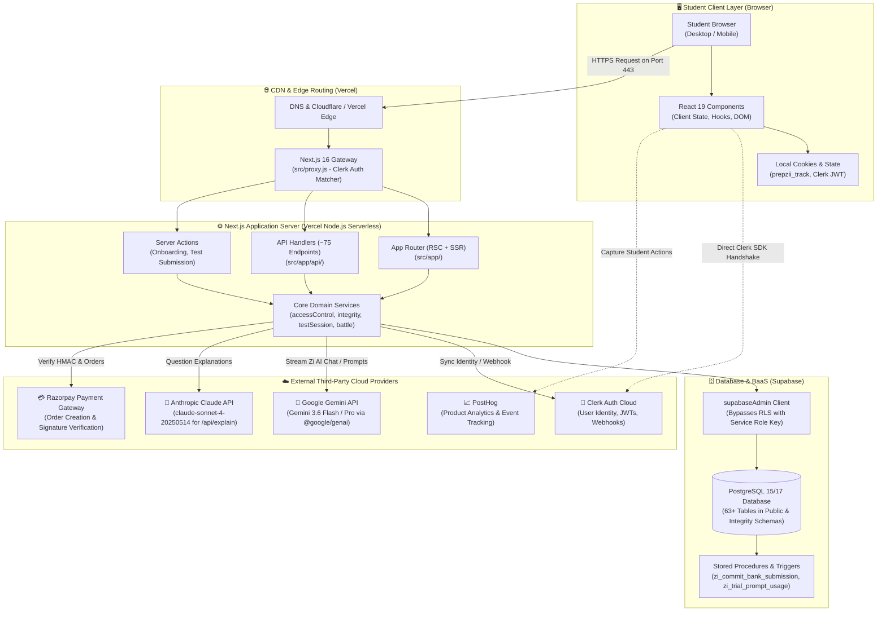

# 🏗️ Prepzii: Complete System Overview

> **"Prepzii actually kaise bana hua hai?"**  
> Is document mein hum bird's-eye-view se dekhenge ki jab ek student Prepzii open karta hai, to actually background mein kaun-kaun se components aapas mein communicate karte hain.

---

## 🧐 Reality Check: Prepzii Monolith Hai Ya Microservices?

Engineering world mein sabse common misconception hota hai: *"Humne AI use kiya hai, payment hai, auth hai, to yeh microservices architecture hoga!"*

**Truth:** Prepzii is an **Optimized Serverless Monolith with Managed Cloud Services (BaaS - Backend as a Service)**.
- Saara frontend UI, backend API routes, server actions, aur business logic **ek hi repository (`ai-study-web`)** mein rehta hai.
- Complex backend infrastructure (Database, Auth, LLM Hosting, Payment Gateway) ko khud host karne ki jagah specialized managed services ko delegate kiya gaya hai:
  - **Auth**: Clerk Cloud
  - **Database & Storage**: Supabase Hosted PostgreSQL
  - **AI Intelligence**: Google Gemini (Direct API) + Anthropic Claude (Legacy/Explain API)
  - **Payments**: Razorpay
  - **Hosting & Compute**: Vercel Serverless & Edge Network

---

## 📊 End-to-End Bird's-Eye View Diagram



---

## 🛠️ The Real Tech Stack (Code-Verified)

Package versions are derived directly from `package.json`:

| Component / Layer | Technology | Actual Version in Code | Purpose in Prepzii |
|---|---|---|---|
| **Frontend Framework** | Next.js (App Router) | `^16.3.0` | Server-Side Rendering (SSR), React Server Components (RSC), App Routing. |
| **UI Library** | React | `19.2.4` | Modern declarative component tree, Actions, concurrent rendering. |
| **Styling Engine** | Tailwind CSS 4 | `^4.3.3` | Ultra-fast CSS styling using `@tailwindcss/postcss`. |
| **Component Primitives** | Radix UI + Lucide React | Radix `^1.6.7`, Lucide `^1.23.0` | Accessible modals, dialogs, dropdowns, and clean SVG iconography. |
| **Math / KaTeX Engine** | KaTeX, Rehype-KaTeX, Remark-Math | KaTeX `^0.16.10` | High-fidelity rendering of complex JEE/NEET equations, formulas, and matrices. |
| **Authentication** | Clerk Next.js SDK | `@clerk/nextjs ^7.5.14` | Student registration, Google login, session cookies, user metadata. |
| **Database** | PostgreSQL via Supabase | `@supabase/supabase-js ^2.110.1` | Relational storage for 63+ tables (questions, test attempts, ranks, battles). |
| **Server Database Access** | Supabase Admin (`service_role`) | Custom module in `src/lib/supabaseAdmin.js` | Backend privileged access bypassing Row Level Security for trusted routes. |
| **Primary AI Engine** | Google Gen AI SDK | `@google/genai ^2.21.0` | Powers Zi AI Companion using `gemini-3.6-flash` and `gemini-3.6-pro`. |
| **Secondary AI Engine** | Anthropic Claude API | Direct HTTPS Fetch (`claude-sonnet-4-20250514`) | Legacy on-demand AI explanation in `src/app/api/explain/route.js`. |
| **Payment Gateway** | Razorpay Node SDK | `razorpay ^2.9.8` | Order initialization, checkout modal, and HMAC SHA256 signature verification. |
| **Telemetry & Analytics** | PostHog JS | `posthog-js ^1.422.5` | User behavior tracking, session metrics, funnel drop-off analytics. |
| **Schema Validation** | Zod | `^4.4.3` | Runtime input validation for API payloads, Zi AI actions, and test configs. |

---

## 🔄 The Life of a Student Request (Step-by-Step Flow)

Jab ek student browser mein `prepzii.com/dashboard` enter karta hai ya kisi button par click karta hai:

```
1. Student Browser
   │  Sends HTTP GET /dashboard with Cookie (Clerk Session JWT + prepzii_track)
   ▼
2. Vercel Edge / src/proxy.js
   │  - Matches protected route pattern: `/dashboard(.*)`
   │  - Invokes Clerk middleware to verify JWT authenticity
   │  - If unauthenticated, immediately redirects to /sign-in
   ▼
3. Next.js App Router (Server-Side Execution)
   │  - Executes `src/app/(dashboard)/layout.js` on Node.js runtime
   │  - Calls `getAuthContext()` to fetch user metadata from Clerk & Supabase
   │  - Calls `getUserAccessContext()` to evaluate Plan (FREE, PRO, AI_MODE)
   │  - Renders React Server Components (RSC) to HTML payload
   ▼
4. Database Queries (Supabase via supabaseAdmin)
   │  - Selects user XP, streak, active daily goals, and recent study sessions
   ▼
5. Server Response to Browser
   │  - Streams fast HTML with preloaded fonts and CSS
   │  - Client React "hydrates" interactive buttons (Zi floating widget, start test)
   ▼
6. Asynchronous Background Calls
   │  - Student clicks "Ask Zi" -> Initiates HTTP POST to `/api/zi/chat`
   │  - Node server validates prompt, checks rate limits, streams Gemini response
```

---

## 🧩 Architectural Strengths & Key Design Choices

1. **Server-Side Security First**:
   - Students cannot tamper with their scores or subscription status because all calculations (test evaluation, XP awards, plan checks) happen **strictly on the server** via `supabaseAdmin` and Next.js API routes.
2. **Track Separation (JEE vs NEET)**:
   - Prepzii keeps JEE and NEET data separated logically. A cookie `prepzii_track` determines the active focus, ensuring a NEET student doesn't see Calculus questions or JoSAA engineering cutoffs by mistake.
3. **Optimistic Locking & Concurrency Guarding**:
   - Test sessions employ revision tracking (`revision` counter) and database locking (`withBankSubmissionLock`) to prevent double submissions or race conditions.
