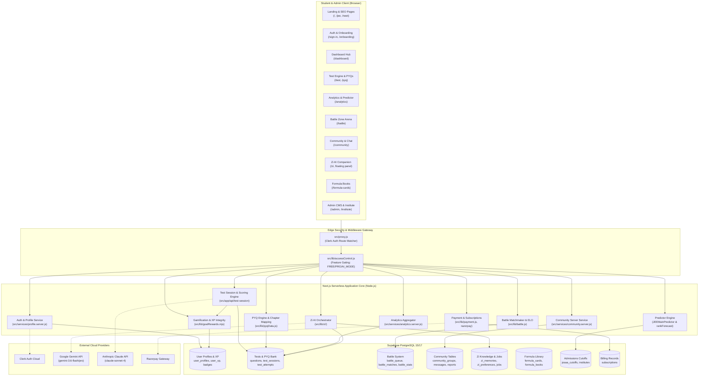

# 🏛️ Prepzii: High Level Design (HLD)

> **High Level Design (HLD)** system ke macro-architecture ko describe karta hai.  
> Is document mein Prepzii ke 18 functional modules ka comprehensive audit, unke file paths, database tables, APIs, external dependencies, aur unka exact implementation status document kiya gaya hai.

---

## 🗺️ Master High-Level Architecture Diagram

---

## 📦 Verified Module Inventory (18 Functional Modules)

Neeche di gayi table mein repository ke sabhi modules ka status, location, aur connections ka exact analysis hai:

### 1. Landing Page & Public SEO
- **What it does**: Public-facing marketing homepage, value proposition showcase, feature comparisons, and SEO landing pages for JEE/NEET.
- **Location in Repo**: `src/app/page.js`, `src/app/HomePageClient.jsx`, `src/app/jee/page.js`, `src/app/neet/page.js`.
- **Frontend Components**: `src/components/ui/tubelight-navbar.jsx`, `src/components/Footer.jsx`, `src/components/ExamHub.jsx`.
- **APIs Called**: None (Server-rendered static & ISR).
- **DB Tables Used**: None.
- **External Services**: PostHog for telemetry.
- **Status**: ✅ **Implemented & Production Ready**.

### 2. Student Authentication & Session Management
- **What it does**: Handles student sign-up, login, passwordless Google SSO, session token storage, and route authorization.
- **Location in Repo**: `src/proxy.js`, `src/lib/auth.js`, `src/app/(auth)/sign-in/`, `src/app/(auth)/sign-up/`, `src/app/api/webhooks/clerk/route.js`.
- **Frontend Components**: `<SignIn />`, `<SignUp />` from `@clerk/nextjs`.
- **APIs Called**: `/api/webhooks/clerk` (handles `user.created`).
- **DB Tables Used**: `user_profiles`.
- **External Services**: Clerk Cloud Auth.
- **Status**: ✅ **Implemented & Active**.

### 3. Student Onboarding
- **What it does**: Collects student target exam (JEE or NEET), graduation/target year, full name, unique username, and account type (`STUDENT` vs `INSTITUTE_ADMIN`).
- **Location in Repo**: `src/app/onboarding/page.js`, `src/components/OnboardingForm.jsx`, `src/lib/username.js`.
- **APIs Called**: Next.js Server Action `completeOnboarding` in `src/app/onboarding/page.js`, and `/api/username/availability`.
- **DB Tables Used**: `user_profiles`.
- **External Services**: Clerk user metadata updates (`updateUserMetadata`).
- **Status**: ✅ **Implemented & Active**.

### 4. Unified Dashboard
- **What it does**: Central student workspace. Shows active streak, XP progress, level status, countdown to target exam, active daily goals, quick test launchers, and recent study activity.
- **Location in Repo**: `src/app/(dashboard)/dashboard/page.js`, `src/app/(dashboard)/layout.js`.
- **Frontend Components**: `DailyGoalsClient.jsx`, `StreakWidget.jsx`, `RecentSessions.jsx`, `TrackWrapper.jsx`, `DashboardHeaderQuote.jsx`.
- **APIs Called**: `/api/dashboard-stats`, `/api/daily-goals`, `/api/study-sessions/recent`.
- **DB Tables Used**: `user_profiles`, `user_xp`, `daily_goals`, `user_daily_goals`, `study_sessions`.
- **External Services**: None.
- **Status**: ✅ **Implemented & Active**.

### 5. PYQ Practice & Explorer (Previous Year Questions)
- **What it does**: Search, browse, and solve real past exam questions from JEE Main and NEET (2017–2026). Supports full question papers, chapter-wise slicing, random drills, and bookmarking.
- **Location in Repo**: `src/app/(dashboard)/pyq/`, `src/components/pyq/PYQPractice.jsx`, `src/components/pyq/PYQExplore.jsx`, `src/components/pyq/PYQBookmarks.jsx`.
- **APIs Called**: `/api/pyq`, `/api/pyq/papers`, `/api/pyq/chapters`, `/api/pyq-attempts`, `/api/pyq-bookmarks`, `/api/pyq/analytics`, `/api/pyq/leaderboard`.
- **DB Tables Used**: `pyq_exams`, `chapters`, `pyq_questions`, `pyq_attempts`, `pyq_bookmarks`.
- **External Services**: None.
- **Status**: ✅ **Implemented & Active**.

### 6. Mock Test Engine & Test Builder
- **What it does**: Allows students to take full-length mock tests or build custom practice tests by selecting subject, chapter, question count, and timer duration. Enforces proctoring (fullscreen lock, tab-switch tracking).
- **Location in Repo**: `src/app/(dashboard)/test/`, `src/components/test/TestBuilder.jsx`, `src/components/test/QuickTest.jsx`, `src/app/(dashboard)/test/session/page.js`.
- **APIs Called**: `/api/test-session` (GET to load session, POST to submit), `/api/test/practice-availability`.
- **DB Tables Used**: `test_sessions`, `test_questions`, `questions`, `test_attempts`, `user_answers`.
- **External Services**: None.
- **Status**: ✅ **Implemented & Robust** (Includes concurrency locking and revision tracking).

### 7. Test Evaluation & Scoring
- **What it does**: Calculates total score (+4 for correct MCQ, -1 for incorrect, 0 for unattempted), computes accuracy percentage, marks questions for review, and grants XP/gamification rewards.
- **Location in Repo**: `src/app/api/test-session/route.js`, `src/lib/analyticsHelpers.js`, `src/app/(dashboard)/test/result/[id]/page.js`, `src/app/(dashboard)/test/review/[id]/page.js`.
- **Frontend Components**: Result summaries, question review cards with KaTeX equations and diagram previews.
- **APIs Called**: `/api/test-attempts/[id]`, `/api/test-attempts/[id]/review`.
- **DB Tables Used**: `test_attempts`, `user_answers`, `user_xp`.
- **Status**: ✅ **Implemented & Active**.

### 8. Performance Analytics & Exam Readiness Index
- **What it does**: Aggregates test and PYQ historical data to generate score trends, subject accuracy heatmaps, weak chapter diagnosis, speed-vs-accuracy analysis, and an overall Readiness Index.
- **Location in Repo**: `src/app/(dashboard)/analytics/page.js`, `src/services/analytics.server.js`, `src/lib/analyticsAggregate.js`.
- **Frontend Components**: `src/components/analytics/AnalyticsClient.jsx`, `src/components/analytics/AIComponents.jsx`.
- **APIs Called**: `/api/analytics` (Requires Prepzii Pro access).
- **DB Tables Used**: `test_attempts`, `pyq_attempts`, `user_answers`, `questions`, `pyq_questions`.
- **Status**: ✅ **Implemented & Active** (Pro gated).

### 9. JEE College & Branch Predictor
- **What it does**: Predicts JEE Main CRL / Category rank based on accuracy and mock test scores, or custom score/percentile inputs. Filters JoSAA round cutoff data to suggest Dream, Target, and Safe colleges & branches.
- **Location in Repo**: `src/components/analytics/JEEMainPredictor.jsx`, `src/data/admission/jee-main/marks-percentile-2026.json`, `src/data/admission/josaa/cutoffs-2026.json`, `src/scripts/import_josaa_cutoffs.js`.
- **APIs / DB Queries**: Queries `josaa_cutoffs` table in Supabase via `src/lib/supabaseClient.js`, with automatic fallback to embedded JSON cutoffs.
- **DB Tables Used**: `josaa_cutoffs`.
- **Status**: ✅ **Implemented & Active inside Analytics**.

### 10. NEET Rank & Percentile Forecast
- **What it does**: Mathematical rank and percentile interpolation engine for NEET aspirants based on historical score distributions (0 to 720 score range).
- **Location in Repo**: `src/lib/neet/rankForecast.js`, `src/lib/neet/historicalData.js`, `src/lib/neet/scoring.js`.
- **Frontend Components**: Rendered within NEET analytics views.
- **Status**: ✅ **Implemented & Active**.

### 11. Battle Zone (1v1 PvP Competitive Testing)
- **What it does**: Real-time / pseudo-realtime competitive 1v1 battle arena. Students enter a matchmaking queue, are paired with an opponent on the same track, compete over timed questions, and gain/lose ELO rating points.
- **Location in Repo**: `src/app/(dashboard)/battle/`, `src/components/battle/BattleArenaClient.jsx`, `src/components/battle/BattleRoomClient.jsx`, `src/components/battle/BattleMatchmakingModal.jsx`, `src/lib/battle.js`.
- **APIs Called**: `/api/battle/queue`, `/api/battle/matches/[id]`, `/api/battle/matches/[id]/answers`, `/api/battle/matches/[id]/finish`, `/api/battle/leaderboard`, `/api/battle/feed`.
- **DB Tables Used**: `battle_queue`, `battle_matches`, `battle_players`, `battle_answers`, `battle_questions`, `battle_stats`, `battle_seasons`, `battle_season_stats`, `battle_events`.
- **Status**: ✅ **Implemented & Active** (Uses database polling state-machine).

### 12. Peer Community & Study Groups
- **What it does**: Student study groups, group chat messaging, 1-on-1 direct conversations, membership requests, and community moderation/reporting tools.
- **Location in Repo**: `src/app/(dashboard)/community/`, `src/services/community.server.js`, `src/lib/community/permissions.js`.
- **APIs Called**: `/api/community/groups`, `/api/community/groups/[id]/messages`, `/api/community/direct/conversations`, `/api/community/direct/messages`, `/api/community/reports`, `/api/community/blocks`.
- **DB Tables Used**: `community_groups`, `community_group_members`, `community_group_messages`, `community_direct_conversations`, `community_direct_messages`, `community_join_requests`, `community_reports`, `community_user_blocks`.
- **Status**: ✅ **Implemented & Active**.

### 13. AI Tutor Zi (Companion Engine)
- **What it does**: Interactive conversational AI tutor specialized in JEE/NEET. Features streaming markdown responses, LaTeX math rendering, personal learning memory extraction, student context awareness, and audio voice transcription.
- **Location in Repo**: `src/lib/zi/`, `src/components/zi/ZiPanel.jsx`, `src/components/zi/ZiLauncher.jsx`, `src/app/api/zi/chat/route.js`, `src/app/api/zi/transcribe/route.js`.
- **APIs Called**: `/api/zi/chat`, `/api/zi/preferences`, `/api/zi/memories`, `/api/zi/transcribe`.
- **DB Tables Used**: `zi_memories`, `zi_preferences`, `user_profiles`, `subscriptions`.
- **External Services**: Google Gemini API (`@google/genai`).
- **Status**: ✅ **Implemented & High Fidelity**.

### 14. AI Test Generator & Jobs Orchestration
- **What it does**: AI test generation wizard that creates tailored tests from syllabus topics. Uses cryptographic AES-256-GCM tokens for stateless configuration.
- **Location in Repo**: `src/lib/zi/testGenerator/builder.server.js`, `src/app/api/zi/test-builder/route.js`, `src/app/api/zi/generation-jobs/route.js`.
- **DB Tables Used**: `zi_generated_tests`, `zi_generated_questions`, `zi_generated_sessions`, `zi_generation.jobs`.
- **Status**: ⚠️ **Partially Implemented / Gated by Feature Flag**. The configuration builder, crypto tokens, validation schemas, and database tables are fully built; however, live background execution is gated behind `ZI_AI_TEST_GENERATION_ENABLED === "true"` to prevent unbounded LLM costs during trials.

### 15. Revision & Formula Handbooks
- **What it does**: Subject-wise formula revision flashcards (Physics, Chemistry, Maths, Biology) and downloadable / viewable PDF formula books.
- **Location in Repo**: `src/app/formula-cards/`, `src/app/formula-books/`, `src/lib/formulaCards.js`, `src/lib/formulaBooks.js`.
- **APIs Called**: `/api/formula-books`, `/api/formula-books/[id]`.
- **DB Tables Used**: `formula_subjects`, `formula_chapters`, `formula_cards`, `formula_books`.
- **Status**: ✅ **Implemented & Active**.

### 16. Gamification System (XP, Levels, Badges, Streaks)
- **What it does**: Awards XP for test completion, PYQ drills, and daily goals. Automatically recalculates levels (Level 1 to 50), tracks daily login streaks, awards milestone badges, and populates the global leaderboard.
- **Location in Repo**: `src/utils/xp.js`, `src/utils/levelEngine.js`, `src/utils/streak.js`, `src/utils/badgeEngine.js`, `src/lib/goalRewards.mjs`, `src/lib/integrity.server.mjs`.
- **DB Tables Used**: `user_xp`, `badges`, `user_badges`, `daily_goals`, `user_daily_goals`.
- **Status**: ✅ **Implemented & Active**.

### 17. Subscriptions & Access Control (Razorpay)
- **What it does**: Enforces feature access boundaries (Free vs Pro vs AI Mode). Initiates Razorpay checkout orders and securely verifies payment signatures on the server using HMAC SHA256 before granting subscription time.
- **Location in Repo**: `src/lib/accessControl.js`, `src/lib/payment.js`, `src/lib/razorpay.js`, `src/app/api/payment/create-order/route.js`, `src/app/api/payment/verify/route.js`.
- **DB Tables Used**: `subscriptions`.
- **External Services**: Razorpay Node SDK & Checkout Modal.
- **Status**: ✅ **Implemented & Production Ready**.

### 18. Admin CMS & Coaching Institute Portals (B2B)
- **What it does**: Admin CMS for managing questions, reviewing feedback, broadcasting notifications, and viewing platform analytics. B2B Institute portal allows coaching institutes to create student batches, assign tests, import questions via CSV, and inspect student rankings.
- **Location in Repo**: `src/app/admin/`, `src/app/institute/`, `src/lib/admin.js`, `src/lib/instituteAuth.js`.
- **APIs Called**: `/api/admin/*`, `/api/institutes/*`.
- **DB Tables Used**: `institutes`, `institute_members`, `institute_batches`, `institute_tests`, `questions`, `pyq_import_packages`.
- **Status**: ✅ **Implemented & Active**.
