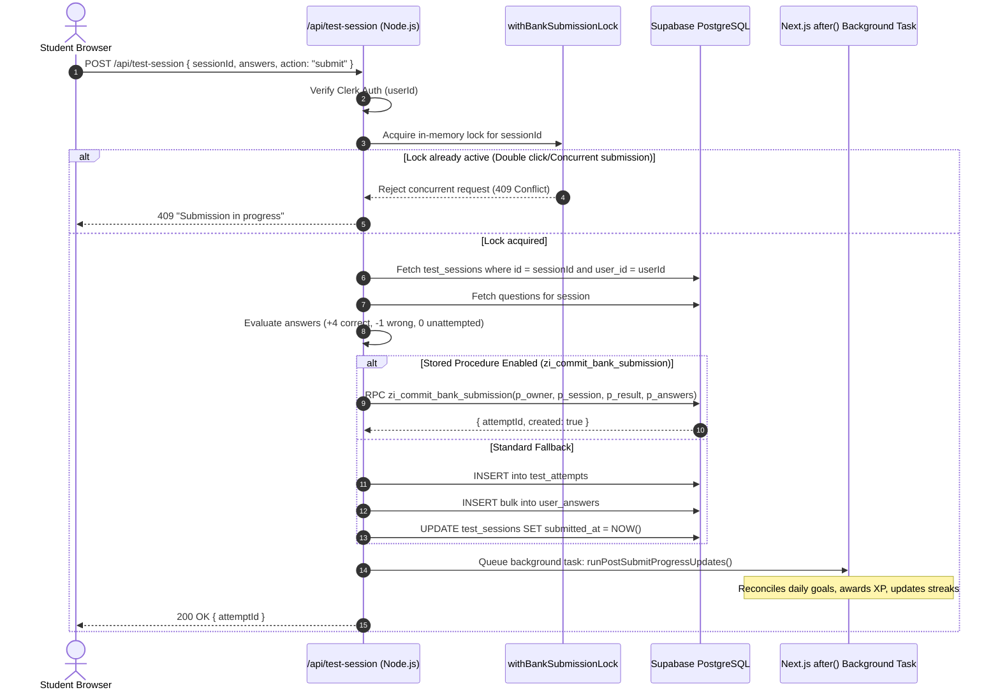
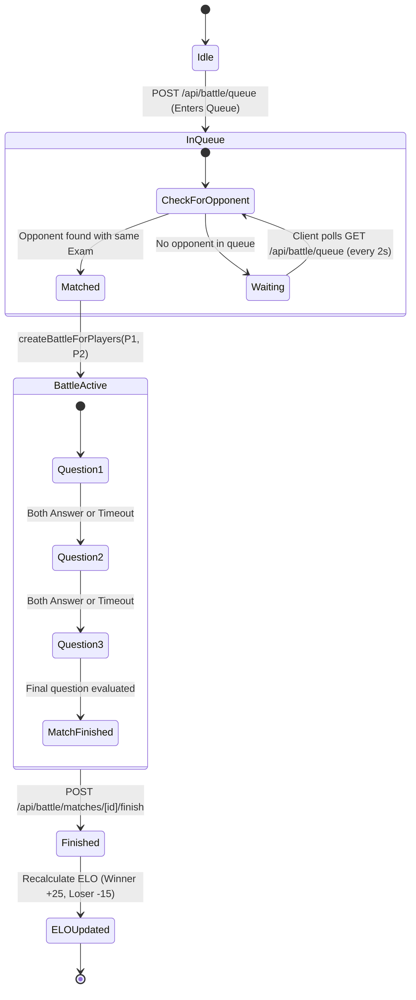

# 🔬 Prepzii: Low Level Design (LLD)

> **Low Level Design (LLD)** code ke exact implementation details, functions, schemas, database mutations, aur algorithms ko uncover karta hai.  
> Is document mein Prepzii ke 6 sabse complex modules ka deep-dive analysis hai with exact code references.

---

## 1. 📝 Test Session Engine & Atomic Submission

Mock tests aur practice sessions Prepzii ka core revenue driver hain. Is module ko high concurrency, cheating prevention, aur score integrity ke liye optimize kiya gaya hai.

### Key Files:
- Endpoint: `src/app/api/test-session/route.js`
- Concurrency & Storage: `src/lib/tests/bankSubmission.server.js`
- Question Adapter: `src/lib/tests/questionSource.server.js`
- Answer Evaluator: `src/lib/tests/answers.js`
- Stored Procedure Cutover: `src/lib/integrity.server.mjs`

### Request & Response Contract (POST /api/test-session - Start Session):
```json
// Request Body
{
  "exam": "JEE",
  "subjects": ["Physics", "Chemistry"],
  "chapters": ["Kinematics", "Thermodynamics"],
  "questionCount": 30,
  "durationMinutes": 60,
  "mode": "custom"
}

// Response (200 OK)
{
  "sessionId": "4a7b9c1d-8e2f-4a3b-9c1d-8e2f4a3b9c1d",
  "track": "JEE",
  "startedAt": "2026-11-03T12:00:00.000Z",
  "deadlineAt": "2026-11-03T13:00:00.000Z",
  "revision": 0,
  "questions": [
    {
      "id": "q-101",
      "subject": "Physics",
      "chapter": "Kinematics",
      "text": "A particle moves in a straight line...",
      "options": ["10 m/s", "20 m/s", "30 m/s", "40 m/s"],
      "question_type": "MCQ",
      "marks": 4,
      "negative_marks": -1
    }
  ]
}
```
*Notice: `correct_option` is stripped out on the server so that students cannot inspect answers in Chrome DevTools network tab!*

### Submission & Scoring Flow (POST /api/test-session - Submit):


---

## 2. 🤖 Zi AI Streaming & Context Pipeline

Zi AI ek conversational AI tutor hai jo student ko JEE/NEET concepts sikhata hai aur step-by-step guidance deta hai.

### Key Files:
- Orchestrator Endpoint: `src/app/api/zi/chat/route.js`
- Google Gemini Runner: `src/lib/zi/provider.js`
- System Prompt Builder: `src/lib/zi/prompt.js`
- Student Context Extractor: `src/lib/zi/studentContext.server.js`
- Long-Term Learning Memories: `src/lib/zi/memories.server.js`
- Rate Limiter: `src/lib/zi/rateLimit.js`
- Action Resolver: `src/lib/zi/actionResolver.server.js`

### Context Ingestion Pipeline:
Jab student message bhejta hai, server seedha LLM ko call nahi karta. Pehle 4 layers ka context gather hota hai:

```
                  ┌─────────────────────────────────────┐
                  │      Student Prompt ("Explain       │
                  │       Bernoulli's Principle")       │
                  └──────────────────┬──────────────────┘
                                     │
    ┌────────────────────────────────┼────────────────────────────────┐
    ▼                                ▼                                ▼
Layer 1: Identity & Track         Layer 2: Learning Memories       Layer 3: Performance History
- User ID & Full Name             - Active memories in DB          - Recent weak chapters
- Exam: JEE Main vs NEET          - Past concept confusions        - Accuracy in Physics
- Subscription: Free/Pro/AI       - Target exam year               - Recent test scores
    │                                │                                │
    └────────────────────────────────┼────────────────────────────────┘
                                     ▼
                     Layer 4: Current Entity Context
                     - Current page URL (/test/session?...)
                     - Active question diagram & LaTeX formula
                                     │
                                     ▼
               ┌───────────────────────────────────────────┐
               │         buildZiSystemPrompt()             │
               │   - Strict Pedagogical Rules (Hinglish)   │
               │   - KaTeX Math Formatting Guidelines      │
               │   - JSON Action Block Grammar             │
               └─────────────────────┬─────────────────────┘
                                     │
                                     ▼
                        Google Gemini 3.6 Flash / Pro
                        (Streamed via Server-Sent Events)
```

### Server-Sent Event (SSE) Protocol:
Server response ko standard JSON mein nahi bhejta; balki chunks stream karta hai:
```
data: {"type": "text_delta", "delta": "Bernoulli's principle states that "}
data: {"type": "text_delta", "delta": "when the speed of a fluid increases, "}
data: {"type": "text_delta", "delta": "its pressure decreases: $P + \\frac{1}{2}\\rho v^2 + \\rho gh = \\text{constant}$."}
data: {"type": "action", "action": {"kind": "formula_card", "subject": "Physics", "chapter": "Fluid Mechanics"}}
data: {"type": "done"}
```

---

## 3. ⚔️ Battle Zone Matchmaker & Arena Engine

Battle Zone mein do students live 1v1 question quiz mein compete karte hain.

### Key Files:
- Queue & Matchmaking: `src/app/api/battle/queue/route.js`
- Battle Match Engine: `src/app/api/battle/matches/[id]/route.js`
- Answer Recorder: `src/app/api/battle/matches/[id]/answers/route.js`
- Domain Logic: `src/lib/battle.js`
- Arena UI: `src/components/battle/BattleArenaClient.jsx`

### Matchmaking State Machine:
Matchmaking database table `battle_queue` aur polling mechanism par operate karta hai:



### ELO Rating Calculation (`src/lib/battle.js`):
Battle score calculation standard chess ELO algorithm follow karta hai:
$$E_A = \frac{1}{1 + 10^{(R_B - R_A) / 400}}$$
$$R'_A = R_A + K \cdot (S_A - E_A)$$
Jahan:
- $K = 32$ (Rating sensitivity factor)
- $S_A = 1$ agar Player A jeet gaya, $0.5$ for draw, $0$ agar haar gaya.

---

## 4. 💳 Payment & Razorpay Subscription Engine

Payments platform ka commercial lifeline hai. Prepzii Razorpay standard checkout flow use karta hai with server-side HMAC validation.

### Key Files:
- Order Creator: `src/app/api/payment/create-order/route.js`
- Signature Verifier: `src/app/api/payment/verify/route.js`
- Access Gating: `src/lib/accessControl.js`
- Client SDK Wrapper: `src/lib/payment.js`

### Cryptographic Security Check:
Client se aane wale kisi bhi data par trust nahi kiya jata. `/api/payment/verify` mein server khud HMAC SHA256 digest calculate karta hai:

```javascript
// Actual verification in src/app/api/payment/verify/route.js (Lines 25-34)
const expectedSignature = crypto
  .createHmac("sha256", process.env.RAZORPAY_KEY_SECRET || "")
  .update(`${razorpay_order_id}|${razorpay_payment_id}`)
  .digest("hex");

const suppliedSignature = String(razorpay_signature);

// Timing-safe comparison to prevent timing attacks
if (
  expectedSignature.length !== suppliedSignature.length ||
  !crypto.timingSafeEqual(
    Buffer.from(expectedSignature),
    Buffer.from(suppliedSignature)
  )
) {
  return NextResponse.json({ success: false, message: "Invalid payment signature" }, { status: 400 });
}
```

---

## 5. 🎯 Admissions & College Prediction Algorithms

### A. JEE Main CRL Rank & Percentile Interpolator
- **File**: `src/components/analytics/JEEMainPredictor.jsx`
- **Data Source**: `src/data/admission/jee-main/marks-percentile-2026.json`
- **Algorithm**:
  Marks ko historical distribution brackets ke beech piece-wise linear interpolation se calculate kiya jata hai:
  $$\text{Percentile} = P_{\text{low}} + \left(\frac{\text{Score} - S_{\text{low}}}{S_{\text{high}} - S_{\text{low}}}\right) \times (P_{\text{high}} - P_{\text{low}})$$
  $$\text{Rank} = \max\left(1, \text{round}\left(\frac{100 - \text{Percentile}}{100} \times \text{TotalCandidates}\right)\right)$$
- **JoSAA Matching**:
  JoSAA cutoffs table (`josaa_cutoffs`) se student ki category, home state (Home State vs Other State quota), aur branch preference ke opening/closing ranks compare kiye jaate hain:
  - **Safe**: Student's Rank < Closing Rank * 0.85
  - **Target**: Closing Rank * 0.85 <= Student's Rank <= Closing Rank * 1.15
  - **Dream**: Closing Rank * 1.15 < Student's Rank <= Closing Rank * 1.50

### B. NEET Rank & Percentile Forecast
- **File**: `src/lib/neet/rankForecast.js`
- **Data Source**: `src/lib/neet/historicalData.js`
- **Clamping**: Score is clamped strictly between 0 and 720. Bracket search matches candidate score, calculates median rank, min rank, max rank, and percentile.

---

## 6. 🏆 Gamification & Goal Rewards Engine

### Key Files:
- Reconciliation: `src/lib/goalRewards.mjs`
- Level Scaling: `src/utils/levelEngine.js`
- Streak Tracker: `src/utils/streak.js`
- Badges: `src/utils/badgeEngine.js`

### Level Progression Curve (`src/utils/levelEngine.js`):
Levels linear nahi hain, quadratic progression follow karte hain taaki higher levels achieve karna challenging ho:
$$\text{XP Required for Level } N = 100 \times N^{1.5}$$
- Level 1: 0 – 100 XP
- Level 5: ~1,118 XP
- Level 10: ~3,162 XP
- Level 20: ~8,944 XP
- Level 50: ~35,355 XP
