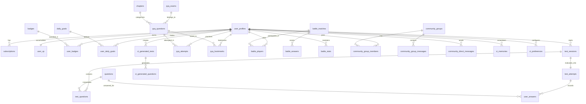

# 🗄️ Prepzii: Database Architecture & Design

> **Supabase PostgreSQL Schema Deep-Dive**  
> Is document mein Prepzii ke 63 database tables, unke relationships, primary/foreign keys, indexes, Row Level Security (RLS) policies, aur custom stored procedures ka complete analysis hai.

---

## 🗺️ Entity Relationship Diagram (ERD)



---

## 📊 Core Tables Grouped by Domain

Prepzii ke 63 tables ko 9 functional clusters mein group kiya gaya hai:

### Cluster 1: User Identity, Auth & Billing
| Table Name | Primary Key | Key Foreign Keys | Purpose |
|---|---|---|---|
| `user_profiles` | `id` (UUID) | `clerk_user_id` (Unique Text) | Student profile: full name, exam (`JEE`/`NEET`), target year, account type, onboarding status. |
| `subscriptions` | `id` (UUID) | `clerk_user_id` -> `user_profiles` | Active subscription details: `plan` (monthly, yearly, ai_mode), `exam_track`, `status`, `expires_at`, `razorpay_order_id`. |
| `notifications` | `id` (UUID) | None | System-wide or track-specific announcements. |
| `notification_reads` | `id` (UUID) | `user_id`, `notification_id` | Tracks which notifications a student has already read. |

### Cluster 2: Gamification & Engagement
| Table Name | Primary Key | Key Foreign Keys | Purpose |
|---|---|---|---|
| `user_xp` | `id` (UUID) | `user_id` (Unique) | Total XP, current level, daily streak count, last active date. |
| `badges` | `id` (UUID) | None | Badge definitions (e.g., "First Test", "Streak Master", "Physics Prodigy"). |
| `user_badges` | `id` (UUID) | `user_id`, `badge_id` | M:N association of badges awarded to students with `awarded_at`. |
| `daily_goals` | `id` (UUID) | None | Predefined daily study challenges (e.g., "Solve 20 Physics questions"). |
| `user_daily_goals` | `id` (UUID) | `user_id`, `goal_id` | Student daily progress, completion status, and reward claimed timestamp. |
| `study_sessions` | `id` (UUID) | `user_id` | Records student focus time, start time, end time, and subject studied. |

### Cluster 3: Question Bank & Mock Tests
| Table Name | Primary Key | Key Foreign Keys | Purpose |
|---|---|---|---|
| `questions` | `id` (UUID) | None | Central question bank: `question_text`, `options`, `correct_option`, `subject`, `chapter`, `marks`, `question_image`. |
| `test_sessions` | `id` (UUID) | `user_id` | A test in progress: `exam`, `mode`, `duration_minutes`, `started_at`, `revision`. |
| `test_questions` | `id` (UUID) | `session_id`, `question_id` | Questions assigned to a specific test session. |
| `test_attempts` | `id` (UUID) | `session_id`, `user_id` | Evaluated result of a completed test: `score`, `total_marks`, `correct_answers`, `wrong_answers`, `time_taken_seconds`. |
| `user_answers` | `id` (UUID) | `attempt_id`, `question_id` | Exact answers chosen by student: `selected_option`, `is_correct`. |

### Cluster 4: PYQs (Previous Year Questions)
| Table Name | Primary Key | Key Foreign Keys | Purpose |
|---|---|---|---|
| `pyq_exams` | `id` (UUID) | None | Past exam papers (e.g., "JEE Main 2026 24 Jan Shift 1"). |
| `chapters` | `id` (UUID) | None | Canonical chapter and subject taxonomy. |
| `pyq_questions` | `id` (UUID) | `exam_id`, `chapter_id` | Real past exam questions with official marking schemes. |
| `pyq_attempts` | `id` (UUID) | `user_id`, `question_id` | Student practice history for PYQs: `selected_option`, `is_correct`, `attempted_at`. |
| `pyq_bookmarks` | `id` (UUID) | `user_id`, `question_id` | Saved questions for later revision. |
| `pyq_import_packages`| `id` (UUID) | None | Bulk question packages uploaded via Admin CMS. |

### Cluster 5: Battle Zone Arena (1v1 PvP)
| Table Name | Primary Key | Key Foreign Keys | Purpose |
|---|---|---|---|
| `battle_queue` | `id` (UUID) | `user_id` | Live matchmaking queue of students waiting for an opponent. |
| `battle_matches` | `id` (UUID) | None | Active 1v1 match: `status` (ACTIVE, FINISHED), `winner_id`, `created_at`. |
| `battle_players` | `id` (UUID) | `battle_id`, `user_id` | Players participating in a match and their running scores. |
| `battle_answers` | `id` (UUID) | `battle_id`, `user_id` | Answers submitted by each player for each battle question. |
| `battle_stats` | `id` (UUID) | `user_id` | Player ELO rating, total battles, wins, losses, win streak. |
| `battle_seasons` | `id` (UUID) | None | Competitive seasonal leaderboard definitions. |

### Cluster 6: Community & Messaging
| Table Name | Primary Key | Key Foreign Keys | Purpose |
|---|---|---|---|
| `community_groups` | `id` (UUID) | `owner_id` | Student study groups (name, exam track, privacy, member count). |
| `community_group_members` | `id` (UUID) | `group_id`, `user_id` | Membership records and roles (ADMIN, MEMBER). |
| `community_group_messages` | `id` (UUID) | `group_id`, `sender_id` | Group chat message text, timestamp, media links. |
| `community_direct_conversations` | `id` (UUID) | None | 1-on-1 direct conversation containers between two students. |
| `community_direct_messages` | `id` (UUID) | `conversation_id`, `sender_id` | Direct chat messages. |
| `community_reports` | `id` (UUID) | `reporter_id`, `reported_user_id` | Moderation flags for inappropriate messages or spam. |

### Cluster 7: Zi AI Companion
| Table Name | Primary Key | Key Foreign Keys | Purpose |
|---|---|---|---|
| `zi_preferences` | `id` (UUID) | `user_id` (Unique) | Student custom AI settings (preferred tone, explanation depth). |
| `zi_memories` | `id` (UUID) | `user_id` | Long-term memory facts extracted by Zi (e.g. concept confusion in Rotational Motion). |
| `zi_generated_tests` | `id` (UUID) | `owner_id` | Tests generated by AI for personalized practice. |
| `zi_generated_questions` | `id` (UUID) | `test_id` | Questions synthesized by Gemini for the generated test. |
| `zi_trial_prompt_reservations`| `id` (UUID) | `owner_id` | Tracks the 3 free prompts for non-paying users. |

### Cluster 8: Formula Library & Handbooks
| Table Name | Primary Key | Key Foreign Keys | Purpose |
|---|---|---|---|
| `formula_subjects` | `id` (UUID) | None | Physics, Chemistry, Mathematics, Biology taxonomy. |
| `formula_chapters` | `id` (UUID) | `subject_id` | Chapters with formula coverage. |
| `formula_cards` | `id` (UUID) | `chapter_id` | Individual flashcards with LaTeX equations and mnemonics. |
| `formula_books` | `id` (UUID) | None | Complete PDF formula handbooks for offline study. |

### Cluster 9: Admissions & College Predictor
| Table Name | Primary Key | Key Foreign Keys | Purpose |
|---|---|---|---|
| `josaa_cutoffs` | `id` (BigInt/UUID) | None | JoSAA official counseling cutoff ranks (Round 1–5, 2024–2026). Contains `institute_name`, `academic_program_name`, `seat_type`, `quota`, `opening_rank`, `closing_rank`. |

---

## 🔒 Row Level Security (RLS) & Access Modes

Supabase PostgreSQL features **Row Level Security (RLS)**. RLS ensures that even if a student has access to the Supabase client, they can **only read or write their own data**.

### How Prepzii Uses Two Access Modes:
1. **Client-Side (User Session Mode via `useClerkSupabase.js`)**:
   - Uses `NEXT_PUBLIC_SUPABASE_ANON_KEY`.
   - Passes Clerk JWT in the `Authorization: Bearer <token>` header.
   - Restricted by PostgreSQL policies:
     ```sql
     -- Example RLS Policy for Test Attempts
     CREATE POLICY "Students can only read their own attempts"
     ON public.test_attempts
     FOR SELECT
     USING (auth.jwt() ->> 'sub' = user_id);
     ```
2. **Server-Side (Admin Mode via `supabaseAdmin.js`)**:
   - Uses `SUPABASE_SERVICE_ROLE_KEY`.
   - **Bypasses all RLS policies**.
   - Used inside Next.js API Routes (`src/app/api/`) and Server Actions where the server authoritatively validates business rules (e.g. evaluating scores, verifying Razorpay payments, incrementing XP).

---

## 🧑‍🏫 Database Concepts Explained in Plain Hinglish

### 1. Primary Key (PK) Kya Hota Hai?
- **Concept**: Table ki har row ka ek unique "Aadhaar Card number" ya "Roll Number".
- **Prepzii Example**: `user_profiles` table mein `id` (UUID). Do students ka kabhi same ID nahi ho sakta.

### 2. Foreign Key (FK) Kya Hota Hai?
- **Concept**: Ek table ka doosri table ke sath rishta (relationship) jodna.
- **Prepzii Example**: `test_attempts` table mein `user_id` ek foreign key hai jo point karti hai `user_profiles(clerk_user_id)` par. Isse pata chalta hai ki yeh test attempt kis student ka hai.

### 3. Relational Database Kya Hota Hai?
- **Concept**: Aisa database jahan data alag-alag structured tables mein rehta hai aur tables aapas mein connected hoti hain (relations).
- **Prepzii Example**: Hum student ka naam, test questions, aur payment ek hi table mein dump nahi karte. Student alag table mein hai, Questions alag table mein hain, aur Attempt un dono ko connect karta hai.

### 4. JOIN Kya Hota Hai?
- **Concept**: Do ya teen tables ko aapas mein jodkar ek single meaningful report nikalna.
- **Prepzii Example**: Analytics page par hume student ke marks dikhane hain subject-wise. Hum `user_answers` ko `questions` table ke sath JOIN karte hain taaki pata chale ki galat hua question Physics ka tha ya Chemistry ka.

### 5. Index Kya Hota Hai?
- **Concept**: Kitab ke aakhri panno par di gayi index jisse koi chapter dhoondhna aasan ho jata hai bina puri kitab padhe.
- **Prepzii Example**: `josaa_cutoffs` table mein 50,000+ rows hain. Agar hum `institute_name` aur `seat_type` par index nahi lagayein, to search karne mein 2 second lagenge. Index hone se query 5 milliseconds mein execute ho jati hai!
