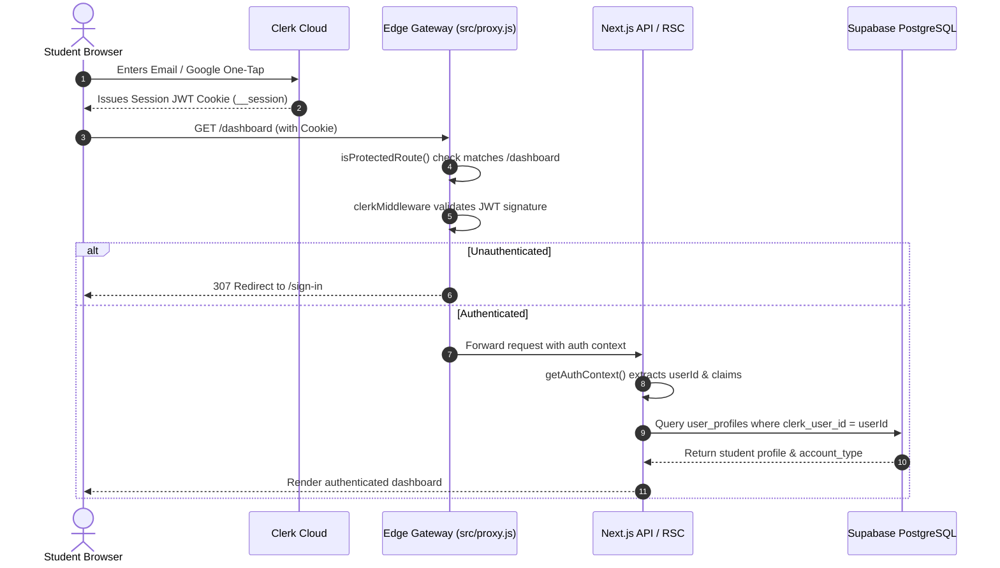

# 🔐 Prepzii: Authentication & Security Architecture

> **Security & Identity Deep-Dive**  
> Is document mein Clerk Auth, Next.js 16 Edge Gateway (`src/proxy.js`), Supabase Service Role isolation, cryptographic HMAC checks, aur platform security boundaries ka exhaustive audit hai.

---

## 🛡️ Authentication Architecture & Data Isolation

Prepzii user authentication ko manage karne ke liye **Clerk Cloud** ka use karta hai aur authorization/data storage ke liye **Supabase PostgreSQL**.



---

## 🚪 The Next.js 16 Gateway: `src/proxy.js`

Next.js 16 canary / release architecture mein middleware convention `src/proxy.js` par point karta hai:

```javascript
// Actual Code in src/proxy.js (Lines 1-18)
import { clerkMiddleware, createRouteMatcher } from "@clerk/nextjs/server";

const isProtectedRoute = createRouteMatcher([
  "/onboarding(.*)",
  "/analytics(.*)",
  "/profile(.*)",
  "/subscriptions(.*)",
  "/test/session(.*)",
  "/test/history(.*)",
  "/test/review(.*)",
  "/test/result(.*)",
  "/pyq/session(.*)",
  "/battle(.*)",
  "/community/messages(.*)",
  "/community/groups/new",
  "/institute/(.*)/tests/(.*)/edit",
  "/admin(.*)",
]);

export default clerkMiddleware(async (auth, req) => {
  if (isProtectedRoute(req)) {
    await auth.protect(); // Forces unauthenticated users to /sign-in
  }
});
```

### Why this is critical:
Har request jo in routes par aati hai, application code execute hone se pehle hi Vercel Edge par verify ho jati hai. Invalid requests server resources ya database queries consume nahi kar sakti.

---

## 🔗 Identity Mapping: Clerk ID to Database Records

Clerk aur Supabase do alag systems hain. Inko aapas mein kaise joda gaya hai?

```
┌────────────────────────────────────────┐
│           Clerk Cloud User             │
│   id: "user_2tX8kL9mNpQrStUvWxYz"      │
│   email: "student@example.com"         │
└──────────────────┬─────────────────────┘
                   │
                   ▼ (Synchronized via Webhook / Onboarding)
┌────────────────────────────────────────────────────────┐
│         Supabase `user_profiles` Table                 │
│   id: "e5b8c9d0-1234-5678-90ab-cdef12345678" (UUID)    │
│   clerk_user_id: "user_2tX8kL9mNpQrStUvWxYz" (Indexed) │
│   full_name: "Rahul Sharma"                            │
│   exam: "JEE"                                          │
│   target_year: 2026                                    │
│   account_type: "STUDENT"                              │
└──────────────────┬─────────────────────────────────────┘
                   │
    ┌──────────────┴──────────────┐
    ▼                             ▼
test_attempts                  user_xp
(user_id = Clerk ID)          (user_id = Clerk ID)
```

**Key Architectural Insight**: Prepzii mein foreign keys directly Clerk ke string ID (`user_2tX...`) ko reference karti hain `user_id` columns mein, jisse har database query directly `auth().userId` ke sath bind ho jati hai bina bar-bar internal UUID lookups kiye.

---

## 👮 Dual Supabase Client Isolation

Prepzii do completely separated Supabase clients use karta hai:

1. **`src/lib/supabaseClient.js` (Client-Safe Anonymous Client)**:
   - Uses `NEXT_PUBLIC_SUPABASE_ANON_KEY`.
   - Exposed to the browser.
   - Restricted strictly by PostgreSQL Row Level Security (RLS) policies.
   - Public data (JoSAA cutoffs, public badges) read karne ke liye safe hai.

2. **`src/lib/supabaseAdmin.js` (Server-Only Service Role Client)**:
   - Uses `SUPABASE_SERVICE_ROLE_KEY`.
   - Protected by `import "server-only";` (Agar koi developer is client ko galti se client component mein import karega, to build instantly fail ho jayega!).
   - Bypasses RLS to perform authoritative mutations (XP grants, score calculations, subscription updates).

---

## 🔎 Security Audit Findings & Potential Gaps

Hamare deep-code audit mein yeh security observations mili hain:

1. **In-Memory Rate Limiter in Serverless Environment**:
   - `src/lib/zi/rateLimit.js` memory store use karta hai: `globalThis.__prepziiZiRateLimitStore = new Map()`.
   - **Architectural Reality**: Serverless platforms (Vercel) multiple parallel container instances spawn karte hain. Agar ek user concurrent requests alag-alag instances ko bhejta hai, to in-memory counter share nahi hota.
   - **Recommendation**: Production scale par Distributed Rate Limiting (Redis / Upstash REST) use karein.

2. **Timing-Safe HMAC Payment Verification**:
   - **Positive Finding**: `/api/payment/verify/route.js` uses `crypto.timingSafeEqual` to prevent side-channel timing attacks on cryptographic signatures. This is industry best-practice.

3. **Origin Header Validation in AI Test Builder**:
   - `src/lib/zi/testGenerator/jobHttp.server.js` validates `hasSameRequestOrigin(request)`, preventing Cross-Site Request Forgery (CSRF) on expensive generation endpoints.

4. **Prompt Injection & Secret Leak Prevention in Zi AI**:
   - `src/lib/zi/memories.server.js` contains a regex blocklist (`SENSITIVE_PATTERNS`) that automatically strips credit cards, passwords, API keys, and OTPs before saving them to long-term database memories.
