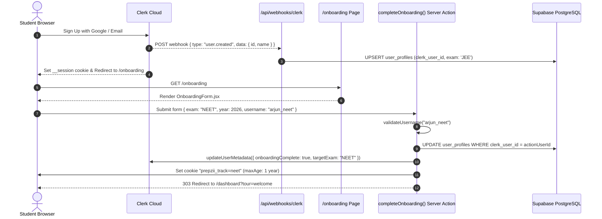
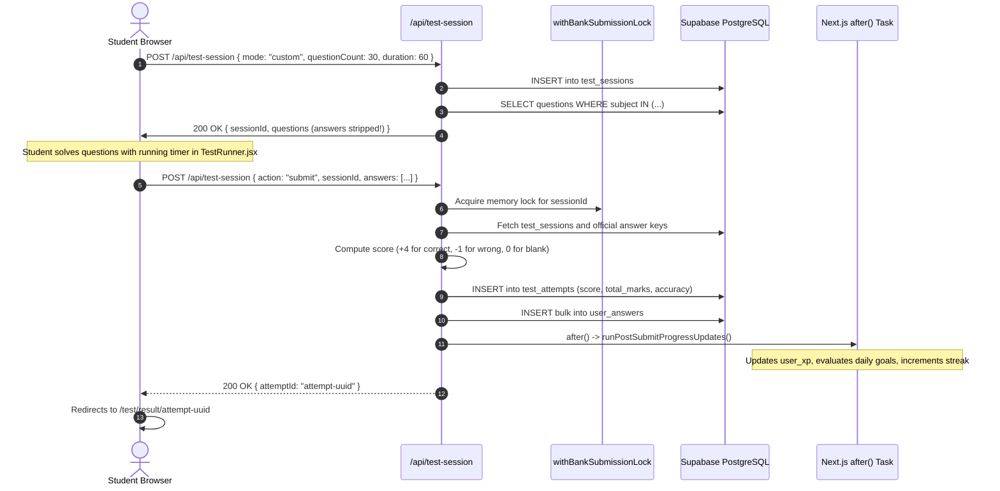
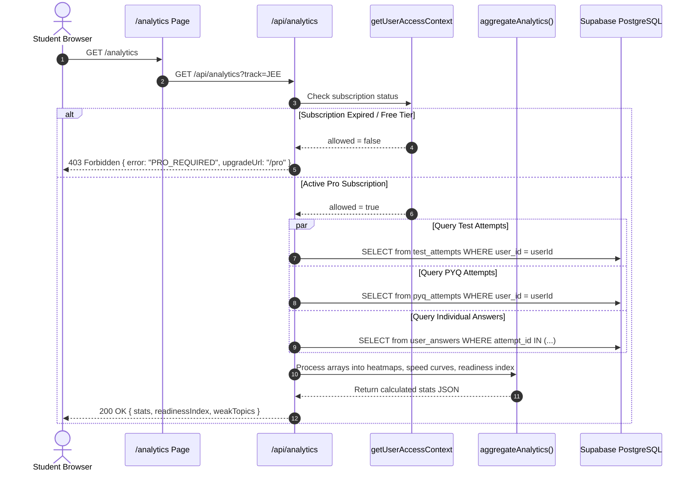
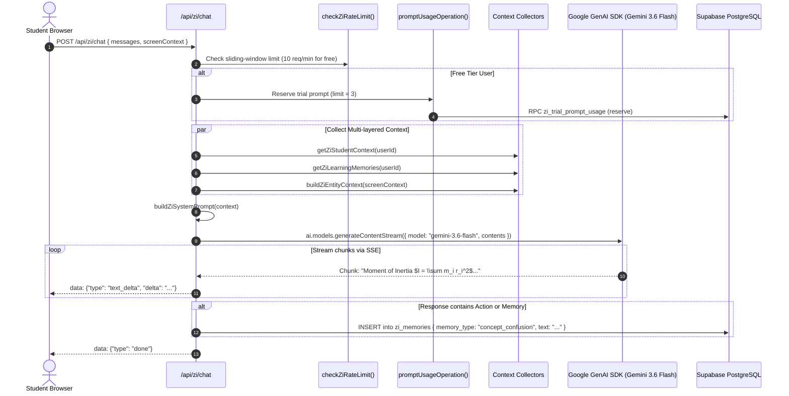
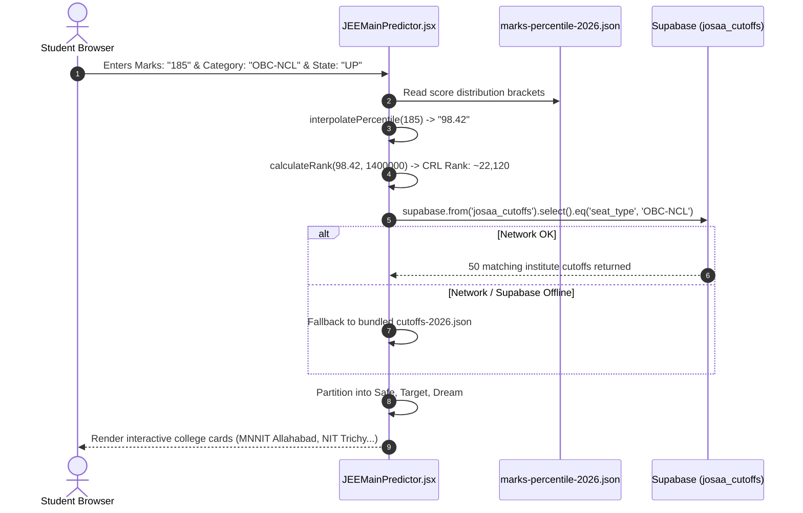
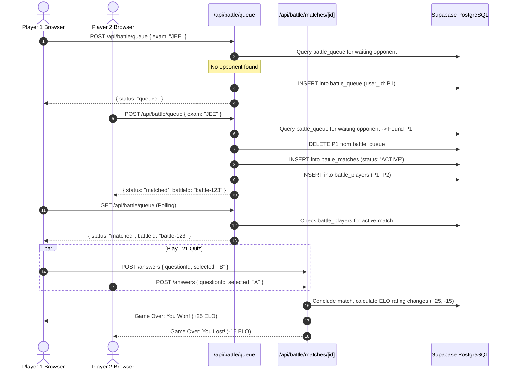

# 🗺️ Prepzii: Real User Journeys (Trace & Execution)

> **Execution Traces of Critical User Flows**  
> Is document mein 6 core user journeys ka end-to-end trace, ordered function calls, database mutations, aur failure edge-cases document kiye gaye hain.

---

## 🏃 Journey 1: Student Signs Up & Completes Onboarding

### Hinglish Explanation:
Student Google One-Tap ya Email se Sign Up karta hai. Clerk account create karta hai aur background mein Clerk Webhook call hota hai jo Supabase ke `user_profiles` table mein base row daal deta hai. Student ko `/onboarding` page par redirect kiya jata hai jahan wo apna Exam (JEE ya NEET), Target Year, Name, aur Username select karta hai. Next.js Server Action database update karta hai, Clerk metadata mein `onboardingComplete: true` set karta hai, cookie store karta hai, aur dashboard par bhej deta hai.

### Mermaid Sequence Diagram:

### Call Chain:
1. `src/app/api/webhooks/clerk/route.js` -> `verifyWebhook(req)` -> `supabaseAdmin.from("user_profiles").upsert()`
2. `src/app/onboarding/page.js` -> `getAuthContext()`
3. `completeOnboarding(formData)` Server Action:
   - `validateUsername()` in `src/lib/username.js`
   - `supabaseAdmin.from("user_profiles").update(profilePayload)`
   - `clerkClient().users.updateUserMetadata()`
   - `cookies().set("prepzii_track", normalizedExam)`

---

## 📝 Journey 2: Student Starts & Submits a Mock Test

### Hinglish Explanation:
Student Custom Test Builder mein jakar 30 questions aur 60 minutes choose karta hai. Backend `test_sessions` mein session create karta hai aur questions fetch karta hai. Student ko questions bheje jaate hain par `correct_option` intentionally hide kar diya jata hai taaki cheating na ho sake. Student test solve karta hai aur "Submit Test" click karta hai. Server atomic lock acquire karta hai, evaluation karta hai (+4, -1 marking), `test_attempts` mein record save karta hai, aur background mein XP aur streak recalculate karta hai.

### Mermaid Sequence Diagram:

---

## 📊 Journey 3: Student Views Performance Analytics

### Hinglish Explanation:
Student sidebar se Analytics click karta hai. Server pehle verify karta hai ki student ke paas active Prepzii Pro subscription hai ya nahi. Agar Free student hai, to 403 status ke sath upgrade prompt milta hai. Agar Pro student hai, to server parallel mein `test_attempts`, `pyq_attempts`, aur `user_answers` query karta hai. Ek pure in-memory mathematical aggregator (`aggregateAnalytics`) accuracy, time-spent, weak chapters aur readiness score compute karke clean visual state render karta hai.

### Mermaid Sequence Diagram:

---

## 💬 Journey 4: Student Asks Zi AI a Question

### Hinglish Explanation:
Student floating Zi AI icon click karta hai aur poochta hai: *"Mujhe Rotational Motion ke Moment of Inertia mein problem ho rahi hai."*
Message backend par `/api/zi/chat` par jata hai. Pehle rate-limit check hota hai. Agar user free hai, to database mein prompt reservation counter increment hota hai. Phir server student ki past history, weak chapters, aur active screen context ko combine karke ek comprehensive system prompt tayar karta hai. Google Gemini API ko request jaati hai aur response server-sent events (SSE) ke through browser mein live stream hota hai. Agar Gemini explanation ke doran koi personalized memory generate karta hai (e.g. "Student struggles with parallel axis theorem"), to background mein wo `zi_memories` table mein save ho jati hai!

### Mermaid Sequence Diagram:

---

## 🎓 Journey 5: Student Uses JEE College Predictor

### Hinglish Explanation:
Analytics page ke andar `JEEMainPredictor.jsx` component student ke mock test scores ya custom entered marks ko read karta hai. Piece-wise linear interpolation se NTA Percentile aur Common Rank List (CRL) rank estimate ki jaati hai. Phir student Category (OBC-NCL, SC, ST, EWS), Home State, aur Branch select karta hai. Browser Supabase se `josaa_cutoffs` table query karta hai (ya bundled 2026 JSON fallback use karta hai). Results ko Safe, Target, aur Dream college badges mein sort karke display kiya jata hai.

### Mermaid Sequence Diagram:

---

## ⚔️ Journey 6: Student Plays in Battle Zone

### Hinglish Explanation:
Student Battle Arena mein "Find Match" click karta hai. Client POST karta hai `/api/battle/queue`. Backend dekhta hai ki kya queue mein koi aur student usi track (JEE/NEET) ka wait kar raha hai. Agar koi nahi hai, to student ko queue mein rakh kar client ko `status: queued` milta hai aur client har 2 second par poll karta hai. Jaise hi doosra student aata hai, match record create hota hai `battle_matches` mein aur dono players ko arena room mein bhej diya jata hai. Questions live solve hote hain aur match khatam hone par ELO ratings update ho jati hain!

### Mermaid Sequence Diagram:

