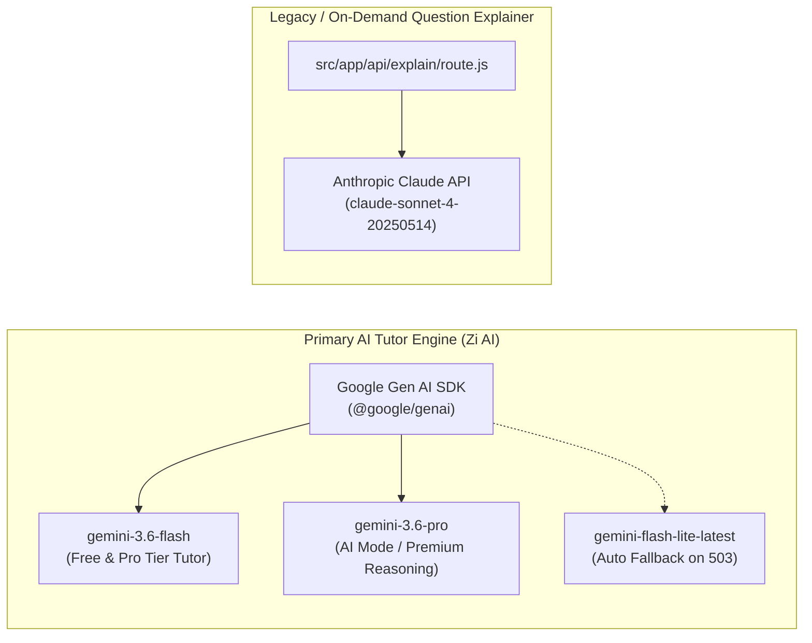

# 🧠 Prepzii: Zi AI Architecture & LLM Orchestration

> **The Artificial Intelligence Engine Behind Prepzii**  
> Is document mein Google Gemini models, prompt synthesis, Server-Sent Events (SSE) streaming, student memory extraction, voice transcription, aur cryptographic test generation ka complete deep-dive hai.

---

## 🤖 Dual AI Model Architecture

Prepzii mein do alag-alag AI providers code mein exist karte hain:



### 1. Primary Engine: Google Gemini (`src/lib/zi/provider.js`)
- **Default Pro Model**: `gemini-3.6-flash` (Fast, cost-efficient, handles LaTeX math and diagrams seamlessly).
- **AI Mode Model**: `gemini-3.6-pro` (Deep multi-step reasoning for high-difficulty JEE Advanced problems).
- **Fallback Resilience**: Agar Google ka API 503 Service Unavailable return karta hai, to `src/lib/zi/provider.js` automatically `gemini-flash-lite-latest` par switch kar deta hai bina user session break kiye.

### 2. Legacy Engine: Anthropic Claude (`src/app/api/explain/route.js`)
- Full mock tests aur PYQ practice ke doran jab student "Explain with AI" par click karta hai, to yeh standalone endpoint Anthropic ke `claude-sonnet-4-20250514` model ko call karke static explanation generate karta hai.

---

## 🧩 The Zi Context Orchestration Pipeline

Zi AI student ko generic ChatGPT jaisa jawab nahi deta; yeh student ke pure academic context ko system prompt mein inject karta hai:

```javascript
// Conceptual flow inside src/app/api/zi/chat/route.js
const systemPrompt = buildZiSystemPrompt({
  student: {
    fullName: "Aryan Patel",
    exam: "JEE",
    targetYear: 2026,
    recentWeakChapters: ["Rotational Motion", "Wave Optics"],
    averageAccuracy: 64.2
  },
  memories: [
    { type: "concept_confusion", text: "Confused between Torque and Angular Momentum" }
  ],
  entityContext: {
    currentRoute: "/test/session?subject=Physics",
    activeFormula: "\\tau = I \\alpha"
  }
});
```

### System Prompt Guidelines (`src/lib/zi/prompt.js`):
1. **Pedagogical Persona**: Zi ek encouraging, empathetic, aur exceptionally sharp JEE/NEET teacher ki tarah act karta hai.
2. **Language**: Conversational **Hinglish** (Roman script Hindi + English technical terms, jaise *"Chalo is formula ko step-by-step simplify karte hain"*).
3. **LaTeX Formatting**: Sabhi mathematical equations aur chemical reactions ko `$inline$` ya `$$display$$` KaTeX delimiters mein enclose karta hai.
4. **Action Blocks**: Agar student practice test maangta hai ya formula sheet dekhna chahta hai, to Zi raw text ke end mein ek structured JSON Action Block emit karta hai jise frontend ek interactive clickable card mein convert kar deta hai!

---

## 🌊 Streaming Protocol: Server-Sent Events (SSE)

Large Language Models (LLMs) ko complete answer generate karne mein 5–15 seconds lag sakte hain. Student ko screen par wait karwake bore karne ke bajaye, Prepzii **Server-Sent Events (SSE)** ke zariye tokens ko real-time mein stream karta hai:

```
Browser                          Next.js Server (/api/zi/chat)            Google Gemini API
   │                                           │                                   │
   │─── POST /api/zi/chat (Prompt) ───────────>│                                   │
   │                                           │─── generateContentStream() ──────>│
   │                                           │<── Token chunk ("Moment") ────────│
   │<── data: {"delta": "Moment "} ────────────│                                   │
   │                                           │<── Token chunk ("of Inertia") ────│
   │<── data: {"delta": "of Inertia "} ────────│                                   │
   │                                           │<── Action block chunk ────────────│
   │<── data: {"action": "formula_card"} ──────│                                   │
   │<── data: {"type": "done"} ────────────────│                                   │
```

---

## 🧠 Long-Term Learning Memory Engine (`src/lib/zi/memories.server.js`)

Har session ke baad Zi student ke baare mein important academic observations ko retain karta hai.

### 6 Memory Types:
1. `concept_confusion`: Student ko kis concept mein bar-bar dikkat ho rahi hai.
2. `study_priority`: Aaj ya is hafte ka primary target kya hai.
3. `temporary_goal`: 7 din ka target (e.g. "Complete Organic Chemistry named reactions").
4. `exam_deadline`: Student ke school exams ya shift timing.
5. `subject_preference`: Kis subject se start karna pasand karta hai.
6. `learning_note`: Student ke specific study habits.

### Privacy & Sensitive Data Scrubbing:
Memory save karne se pehle `src/lib/zi/memories.server.js` ka regex filter automatically sensitive patterns ko detect karke reject karta hai:
- Passwords / OTPs
- API Keys / Auth tokens
- Bank details / UPI PINs
- Medical / personal records

---

## 🎙️ Audio Voice Notes Transcription (`src/app/api/zi/transcribe/route.js`)

Student browser ke microphone button ko hold karke bol sakta hai: *"Sir, mujhe Doppler effect ka formula explain kar dijiye."*
1. Browser audio ko WebM / WAV format mein capture karta hai.
2. Binary payload `/api/zi/transcribe` par POST hota hai.
3. Server Gemini ke multimodal audio understanding capability ko use karke speech-to-text transcribe karta hai.
4. Clean text student ke chat input mein fill ho jata hai!

---

## 🛡️ AI Usage Quotas & Rate Limiting

LLM API calls expensive hoti hain. System abuse aur runaway costs se bachne ke liye 2-tier protection build ki gayi hai:

1. **Sliding-Window Rate Limiter (`src/lib/zi/rateLimit.js`)**:
   - Free Users: 10 requests / minute
   - Pro Users: 50 requests / minute
   - AI Mode: 200 requests / minute
2. **Trial Prompt Accounting (`src/lib/zi/promptUsage.server.js`)**:
   - Free users ko total **3 complimentary prompts** milte hain platform explore karne ke liye.
   - Yeh counter database mein atomic RPC procedure `zi_trial_prompt_usage` se track hota hai with state transitions: `reserve` -> `dispatch` -> `consume`.
   - Counter khatam hone par frontend student ko Prepzii Pro / AI Mode upgrade modal dikhata hai.
